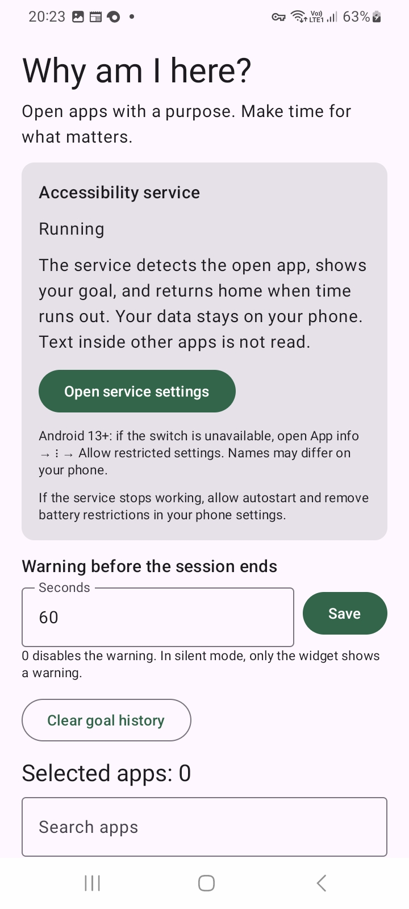
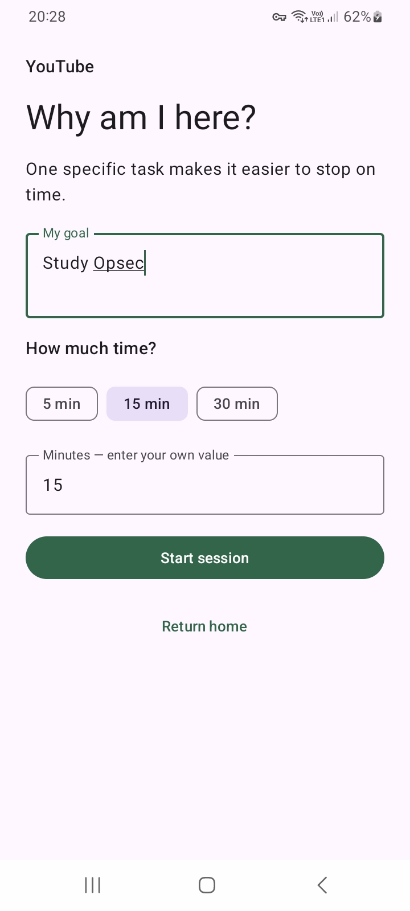

# Why am I here? — Android

[English](README.md) · [Español](README.es.md) · [Русский](README.ru.md)

A small, offline companion for intentional app use. Before opening an app you
choose, write down what you want to do and how much time you need. A floating
widget keeps your goal visible; when time is up, the app returns you home.

**[Download the latest APK](https://github.com/hlophlopgaming/whyiamhereAndroid/releases/latest)** · [MIT license](LICENSE)

## Features

- Choose installed apps with search and icons.
- Set a goal and use 5, 15, 30 minutes, or a custom duration.
- Drag or collapse the goal/timer widget; finish a session early.
- Separate timers for each app, including time spent elsewhere or with the screen off.
- Configurable warning before expiry; visual warnings in silent mode.
- Recent goals, local history, and session restoration after a restart.
- English, Spanish, and Russian, automatically selected from the Android language. Other languages fall back to English. Your own goals are not translated.

**Android 8.0+ · No internet permission · No root · No account · No “Display over other apps” permission.**

## Screenshots

| Settings | Goal for YouTube | Floating reminder |
| --- | --- | --- |
|  |  |  |

## Install

1. Download the `.apk` from [Releases](https://github.com/hlophlopgaming/whyiamhereAndroid/releases).
2. Open it on your phone and allow installation from that source if Android asks.
3. Open **Why am I here?**, select apps, and tap **Open service settings**.
4. Enable the accessibility service and check that its status is **Running**.

On Android 13+, sideloaded apps may need **App info → ⋮ → Allow restricted settings** before their accessibility service can be enabled. Menu names vary by manufacturer. If the service stops, allow autostart and remove battery restrictions.

**Moving from the old 0.2.0 debug build to 0.3.0:** uninstall the old build first.
Its local data will be deleted. Version 0.3.0 introduces the permanent release
signature; subsequent releases use the same key and can update normally.

## Privacy and limitations

All settings, goals, and sessions stay in the app storage on your phone. Backup
and device transfer are disabled. Uninstalling deletes the data. The service
checks the package name of the active window; it does not read screen text,
passwords, or messages. No network permission is requested.

This is a voluntary reminder: you can disable the service, and an app may appear
briefly before the goal form. Returning home does not stop background audio or
video. Time is measured against the phone clock; changing it changes the timer.
Warnings and widget updates happen while the tracked app is visible; expiry in
the background is handled when you return. Reconnecting the service may repeat
a warning sound. Split-screen and PiP follow the focused app window. Firmware
battery restrictions still need testing on your device.

## Build and test

Kotlin, Jetpack Compose Material 3, AccessibilityService, Room, and Preferences
DataStore. minSdk 26, compile/target SDK 37.

Install JDK 17, Android SDK Platform 37.0, and Build Tools 36.0.0. Set `JAVA_HOME`
and `ANDROID_HOME`, or use Android Studio and a local `sdk.dir`.

```sh
./gradlew testDebugUnitTest lintDebug assembleDebug
python3 scripts/check-locales.py
```

Debug APK: `app/build/outputs/apk/debug/app-debug.apk`.
Unit tests cover sessions, expiry, independent timers, restoration, package
filtering, warnings, and time formatting. Device tests cover Room history and
resource selection, including Spanish regions and the English fallback:

```sh
./gradlew connectedDebugAndroidTest
adb logcat -s WhyService
```

The service uses `canRetrieveWindowContent=true` to obtain the active window's
package through Android's window API. It does not traverse text nodes or take
screenshots. [Android API documentation](https://developer.android.com/reference/android/accessibilityservice/AccessibilityServiceInfo).

## Release

See [release instructions](docs/RELEASING.md). The script checks translations,
runs tests and lint, builds a signed, optimized APK, and generates its SHA-256
checksum. Publishing creates an annotated version tag and checks the uploaded
APK before making the GitHub release public.

```sh
scripts/release.sh 0.3.0 --prepare
scripts/release.sh 0.3.0 --publish
```

Keep the permanent signing key and its passwords outside Git and back them up.
R8 and resource shrinking are enabled in release builds.

## Manual checks

Check entry from the launcher, Recents, and notifications; cancelling the goal
form; dragging and collapsing the widget; independent app timers; expiry on
screen and in the background; early finish; silent mode; screen lock; reboot;
changing the Android language; history clearing; and service disable/reconnect.
Check more than one firmware before assuming identical accessibility behavior.
Graphs, schedules, data export, and Google Play distribution are outside this MVP.
